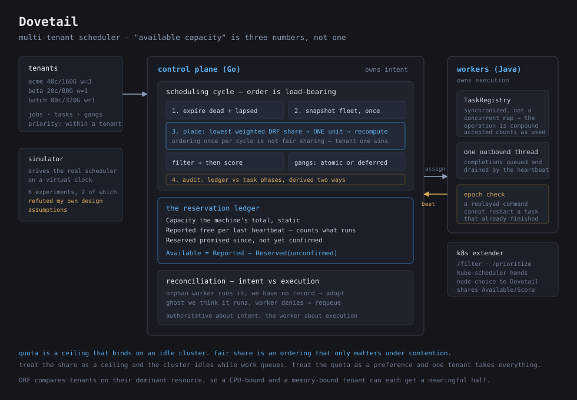

# 🪵 Dovetail

*A multi-tenant cluster scheduler where the hard part is not putting work on machines, but deciding what should run when several tenants want more than exists — and keeping the books straight when a machine disappears mid-task.*



## 🔭 What It Is

A scheduler and control plane for a small cluster. Tenants submit jobs with CPU and memory requirements; the control plane tracks worker state, enforces per-tenant quotas, decides which work is eligible, filters machines that cannot satisfy a request, scores the viable ones, issues reservations, and reconciles its view against what workers actually report.

Two ideas carry most of the weight.

**"Available capacity" is three numbers, not one.** A machine's total capacity is static. What its last heartbeat reported free already accounts for everything it knows it is running. And what the scheduler has *promised* since then — assignments no heartbeat has confirmed yet — is a third quantity. Available capacity is the reported figure minus the unconfirmed promises, and conflating any two of those three is how a scheduler places two tasks into the same gap and then blames the worker.

**Quota and fair share answer different questions.** A quota is a hard ceiling that binds even on an idle cluster, which is what makes a tenant's maximum footprint predictable for capacity planning. A fair share is an *ordering* that only matters under contention, and is explicitly not a limit — one tenant should be able to use the whole cluster when nobody else wants it. Fair sharing is Dominant Resource Fairness, comparing tenants on whichever resource they are most constrained by, so a CPU-bound and a memory-bound tenant can each get a meaningful half.

Beyond that: gang scheduling that is genuinely all-or-nothing, heartbeat-based failure detection kept separate from reservation expiry, a reconciliation pass that treats the control plane as authoritative about *intent* and the worker as authoritative about *execution*, a workload simulator that drives the real scheduler on a virtual clock, and a Kubernetes scheduler extender so a real `kube-scheduler` can delegate node selection.

```
$ ./scripts/demo.sh
   fleet: 3 healthy, 0 warming, 0 stale
   small    usage=  3000m  share=0.250 (cpu)
   greedy   usage=  6000m  share=0.500 (cpu)
   quota rejections: 16  (greedy is capped, small is not)

   killed java-w1; waiting out the heartbeat timeout...
   workers lost: 1   tasks lost: 2   retried: 27
   assignments now: 6  (capacity was reclaimed, not leaked)
```

## ✨ Inspo

I wanted to build a scheduler where the interesting problem was contention rather than dispatch. Putting a task on a machine with room is a filter and a sort. Deciding which of four tenants gets the last eight cores — and then keeping the accounting correct when the machine holding their work stops answering — is a different kind of problem, and it is the one every real scheduler is actually solving.

What I could not have told you beforehand is that the phrase "available capacity" hides three separate quantities. It sounds like one number. Building the thing is what taught me otherwise, and the simulator is what taught me that two of my design beliefs were wrong.

The reading behind it: Ghodsi et al. on [*Dominant Resource Fairness*](https://cs.stanford.edu/~matei/papers/2011/nsdi_drf.pdf) for the fairness algorithm, Verma et al. on [*Borg*](https://research.google/pubs/pub43438/) for the reconciliation framing, and [*Omega*](https://research.google/pubs/pub41684/) for the optimistic-concurrency design Dovetail deliberately does not use.

## 🛠️ Tech Stack

**Go** for the control plane — scheduling, quotas, fair share, placement, reservations, reconciliation, the HTTP API, the simulator, and the Kubernetes extender.

- Standard library only; `go.mod` has no `require` block.
- Virtual clocks throughout. Nothing in the scheduler calls `time.Now()` — every timeout, expiry and staleness check takes time as a parameter, which is what makes the failure paths deterministic rather than sleep-dependent.
- Resource vectors are fixed two-dimensional integers rather than a map, so arithmetic on them is total. A map makes "what is the sum of `{cpu}` and `{cpu, mem}`" a question with no good answer, and the code that answers it wrongly is the code that double-books a machine.

**Java 21** for the workers — the execution side, deliberately a separate process in a separate language so the control-plane boundary had to be a real protocol rather than a function call.

- JUnit 5, test-scoped only. No Jackson, no OkHttp, no logging framework: `java.net.http` plus `java.util.logging` cover six endpoints of flat JSON, and the worker stays a 24 KB jar with no shaded dependencies.
- `TaskRegistry` is `synchronized` rather than built on concurrent collections, because the operation that matters is compound — "is this task known, and if not, reserve capacity and record it" has to be atomic, or two assignments for the same task both succeed.

**Build and verify**

```bash
cd go-control-plane && go test -race ./... && go build ./...
cd ../java-worker  && mvn test && mvn package
cd .. && ./scripts/demo.sh                       # control plane + 3 Java workers + a kill
cd go-control-plane && go run ./cmd/dovetail-sim  # six simulation experiments
```

76 Go tests and 21 Java tests, clean under `-race`.

## 📄 License

MIT. See [LICENSE](LICENSE).
